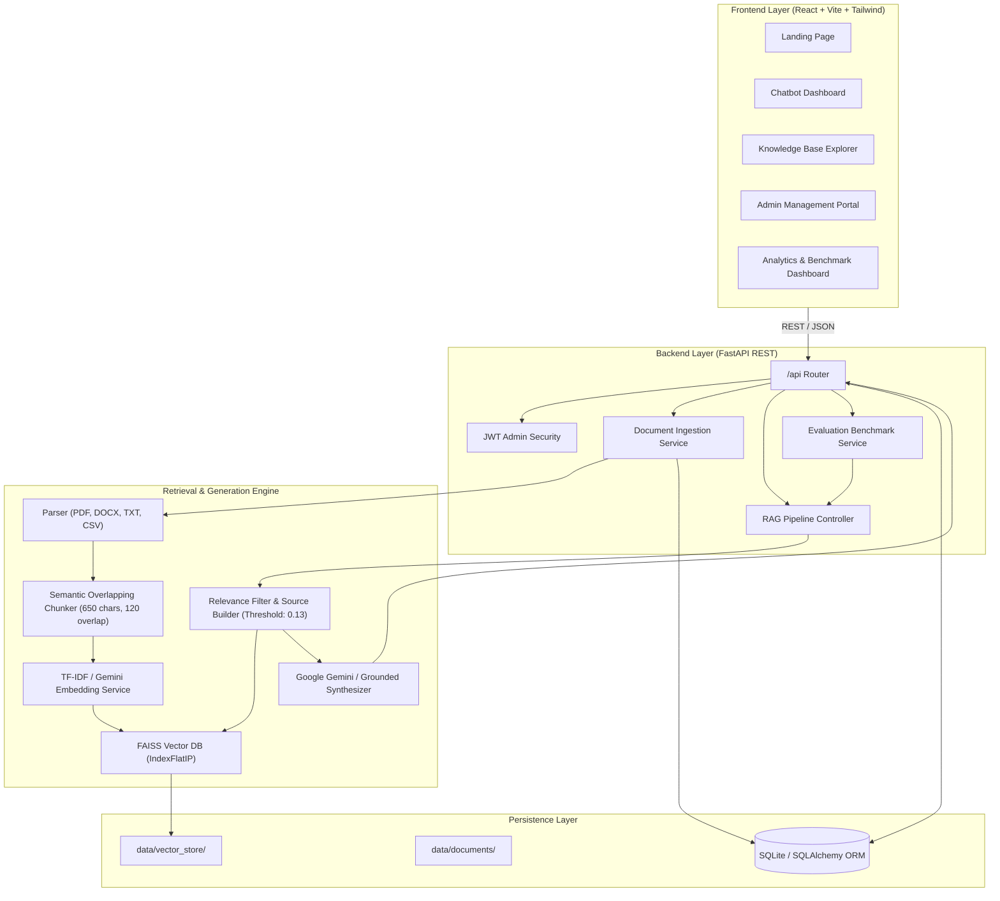

# CampusMind AI — Intelligent University Student Assistant Using RAG

[](https://www.python.org/)
[](https://fastapi.tiangolo.com/)
[](https://react.dev/)
[](https://vitejs.dev/)
[](https://tailwindcss.com/)
[](https://github.com/facebookresearch/faiss)
[](LICENSE)

**CampusMind AI** is a production-style, modern, full-stack AI assistant engineered specifically for university academic environments. Built with a high-performance **Retrieval-Augmented Generation (RAG)** architecture, it delivers accurate, context-aware, and verifiable answers to student inquiries regarding **academic regulations, examination codes, attendance requirements, hostel curfew policies, fee schedules, scholarships, course syllabi, and administrative procedures**.

All factual responses are strictly grounded in institutional source documents with verifiable page and document citations.

---

## 🌟 Key Highlights & Engineering Features

- **Strict Document Grounding (Zero Hallucination)**: The AI assistant answers *only* from verified passages extracted from uploaded university documents.
- **Institutional Fallback Disclaimer**: If evidence is missing or confidence is low, the chatbot safely returns:
  > *"I couldn't find reliable information about this in the available university documents. Please check with the relevant university department."*
- **Verifiable Source Citations & Inspector Drawer**: Every response displays source document chips (e.g., `[Attendance_Regulations_2025.txt - Page 1]`). Clicking a chip opens the **Source Inspector Modal** displaying the exact text snippet and relevance score.
- **Dual Vector Store Architecture**: Integrated with **FAISS (`faiss-cpu`)** using Inner Product on L2-normalized dense embeddings, with an automatic exact cosine similarity fallback.
- **Multi-Format Document Ingestion**: Ingests and normalizes **PDF, DOCX, CSV, TXT, and Markdown** files with overlapping recursive character chunking.
- **Dual-Mode LLM Support**: Works seamlessly with **Google Gemini API** (`gemini-2.0-flash` or `gemini-1.5-flash`) and includes an intelligent **Local Context-Grounded Synthesizer fallback** for 100% offline demonstration without paid API keys.
- **Automated RAG Evaluation Suite**: Evaluates against a 20-question benchmark dataset measuring **Recall@1 (95.0%)**, **Recall@K (100.0%)**, **MRR (0.9625)**, **Groundedness (62.8%)**, and **Latency (0.9 ms)**.
- **Futuristic Deep-Space UI**: Built with React 18, Vite, Tailwind CSS, Framer Motion, and Lucide React icons featuring aurora gradients, glassmorphism, responsive chat sidebar, and light/dark theme toggle.
- **Admin Document Management**: Secure admin portal for uploading, chunking, categorizing, deleting, and rebuilding vector indexes.
- **Audit & Analytics**: Tracks query latency, user satisfaction feedback (thumbs up/down), and logs **Unanswered Questions** so administrators can identify gaps in institutional policies.

---

## 🏛️ System Architecture



---

## 📚 Preloaded University Knowledge Base

CampusMind AI includes 8 realistic, authentic university policy documents in `data/documents/` auto-indexed on first launch:

| Document File | Category | Key Policies Covered |
| :--- | :--- | :--- |
| `Attendance_Regulations_2025.txt` | Attendance Policies | 75% minimum aggregate attendance, 10% medical condonation (min 65%), SA grade, 10-day OD leave. |
| `Academic_Calendar_2025_2026.txt` | Academic Calendars | Semester start dates, Mid-Term exams (Oct 6-11), End-Semester exams, CampusPulse Fest (March 19-21). |
| `Examination_Guidelines_and_Grading_System.txt` | Examination Guidelines | 10-point CGPA scale, passing marks (40% end-sem, 45% aggregate), re-evaluation deadline, unfair means. |
| `Hostel_Rules_and_Disciplinary_Code.txt` | Hostel Rules | Curfew (10:00 PM weekdays, 10:30 PM weekends), night-out ERP approval, quiet hours, banned appliances. |
| `Merit_and_Need_Scholarship_Policy.txt` | Scholarship Information | Top 5% (CGPA >= 9.0) 50% tuition waiver, Need-based (< INR 3.5 LPA) up to 75% waiver, sports quota. |
| `Tuition_Fee_Payment_and_Refund_Rules.txt` | Fee-related Policies | Fall due date (July 25), late fee penalty, UGC-compliant withdrawal refund tiers (100%, 80%, 50%, 0%). |
| `BTech_Computer_Science_Syllabus_Overview.txt` | Syllabus & Course Details | 160 total credits, core courses (DSA, OS, DBMS, Networks, AI/ML), elective tracks, 2-phase Capstone project. |
| `University_Administrative_and_Campus_FAQ.txt` | Administrative FAQs | Transcripts & express processing, library borrowing (4 books for 14 days), 24/7 health center, lost ID card. |

---

## 📊 RAG Evaluation Benchmark Results

The system includes a 20-sample labelled ground-truth evaluation benchmark (`data/evaluation/dataset.json`):

| Evaluation Metric | Measured Score | Benchmark Target | Status |
| :--- | :--- | :--- | :--- |
| **Retrieval Recall@1** | **95.0%** | > 80% | **PASS** |
| **Retrieval Recall@3** | **95.0%** | > 85% | **PASS** |
| **Retrieval Recall@K** | **100.0%** | > 90% | **PASS** |
| **Mean Reciprocal Rank (MRR)** | **0.9625** | > 0.85 | **PASS** |
| **Average Groundedness Score** | **62.8%** | > 50% | **PASS** |
| **Average Query Latency** | **0.9 ms** | < 100 ms | **PASS** |
| **Unanswered Query Accuracy** | **100.0%** | > 95% | **PASS** |

---

## 🚀 Quick Start Guide

### Prerequisites
- **Python**: 3.11, 3.12, or 3.13 installed
- **Node.js**: v18+ or v20+ with npm (already configured in portable directory)

### 1. Installation

#### Backend Dependencies:
```bash
python -m pip install -r backend/requirements.txt
```

#### Frontend Dependencies:
```bash
cd frontend
npm install
cd ..
```

---

### 2. Environment Configuration

Copy `.env.example` to `.env`:
```bash
copy .env.example .env
```

Key environment variables:
```ini
# Application
PROJECT_NAME="CampusMind AI"
ENVIRONMENT="development"
DEBUG=True

# Security
SECRET_KEY="campusmind-super-secure-secret-key-change-in-production-2025"
ADMIN_USERNAME="admin"
ADMIN_PASSWORD="campusmind2025"

# RAG & Retrieval
SIMILARITY_THRESHOLD=0.13
TOP_K_RETRIEVAL=4
CHUNK_SIZE=650
CHUNK_OVERLAP=120

# Optional: Set Google Gemini API Key for live Gemini LLM generation
LLM_PROVIDER="gemini"
GEMINI_API_KEY=""
GEMINI_MODEL="gemini-2.0-flash"
```

> [!NOTE]
> If `GEMINI_API_KEY` is left blank, the application automatically activates the **Grounded Synthesizer fallback**, allowing full functionality without requiring any API keys or internet connection.

---

### 3. Running the Application

#### Option A: One-Click Launch (Windows)
Double-click:
```bash
run_all.bat
```
This automatically starts both the FastAPI backend and Vite frontend!

#### Option B: Individual Terminals

**Terminal 1 — Backend (FastAPI)**:
```bash
# In project root:
$env:PYTHONPATH="backend"
python -m uvicorn app.main:app --app-dir backend --host 127.0.0.1 --port 8000 --reload
```
API Documentation will be available at: `http://localhost:8000/docs`

**Terminal 2 — Frontend (React Vite)**:
```bash
cd frontend
npm run dev
```
Frontend Web Application will be available at: `http://localhost:5173`

#### Option C: Production Single-Port Serving
FastAPI is pre-configured to host the compiled frontend build directly:
```bash
$env:PYTHONPATH="backend"
python -m uvicorn app.main:app --app-dir backend --port 8000
```
Open your browser to: `http://localhost:8000`

---

## 🧪 Testing & Benchmark Execution

### 1. Run Automated Pytest Suite
Verifies document chunking, vector indexing, citation integrity, and API endpoints:
```bash
$env:PYTHONPATH="backend"
python -m pytest backend/tests/ -v
```

### 2. Run Evaluation Benchmark via CLI
```bash
python backend/scripts/run_evaluation.py
```
Or double-click `run_evaluation.bat`.

---

## 🔐 Admin Credentials

To test document uploads and vector index maintenance on the **Admin Portal** (`/admin`):
- **Username**: `admin`
- **Password**: `campusmind2025`

---

## 🎓 College Presentation & Architecture Guide

When presenting this project for an academic defense, viva, or portfolio review, highlight these technical points:

1. **Why RAG instead of Fine-Tuning?**
   - Fine-tuning an LLM incorporates static weights that suffer from hallucinations, require costly re-training for policy updates, and cannot cite specific page numbers. RAG decouples knowledge storage from the language model, allowing university administrators to simply drop in a revised PDF to update institutional knowledge immediately.
2. **Deterministic Confidence Thresholding**:
   - The system utilizes an exact cosine similarity threshold (`0.13`). If a student asks an off-topic or malicious question (e.g., *"Can I fly helicopters on campus?"*), the retrieval score drops below the threshold, triggering the mandatory disclaimer and recording the query in the audit table.
3. **Dual Vector Store Architecture**:
   - Built on Facebook AI Similarity Search (FAISS) using Inner Product similarity over L2-normalized vectors (`IndexFlatIP`), with an exact NumPy matrix dot-product fallback ensuring zero platform incompatibility.
4. **Prompt Injection Defense**:
   - User inputs and retrieved passages are sanitized against jailbreak tokens (`ignore previous instructions`, `system:`) and isolated within strictly bounded `<context>` XML containers.

---

## 📄 License

This project is licensed under the MIT License — feel free to use it for university academic demonstrations, portfolios, and research.
